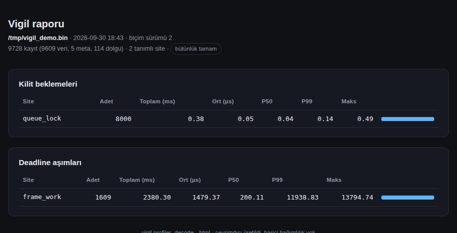

# Vigil

**Uygulama-içi kilit çekişmesi ve deadline izleyicisi.** C++17, Linux. Uygulamanın **işaretlediğin** kilit bekleme sürelerini ve zaman bütçesi aşımlarını, **adlarıyla** (hangi kilit,
hangi bölge), sıcak yolu depolama hızından bağımsız tutarak bir `.bin` dosyasına yazar; çevrimdışı çözücü site bazında özet verir.



> **Durum:** çekirdek, tek çekirdekli bir x86-64 sanal makinede (1 vCPU) kapsamlı olarak test edildi. **Çok çekirdekli,
> ARM, gerçek SD/eMMC ve elektrik kesintisi henüz test edilmedi** (bkz. [Doğrulama durumu](#doğrulama-durumu)). Bu belgedeki tüm
> sayılar o makinede ölçülmüştür ve **hedef donanımda yeniden ölçülmelidir**.

## Ne yapar, ne yapmaz

**Yapar**
- `PROFILE_LOCK_SCOPE*`: bir `std::unique_lock` kilidini almak için beklenen süreyi ve kilidin adını kaydeder.
- `PROFILE_DEADLINE*`: bir kapsamın süresi bütçeyi aşarsa, aşım miktarını ve bölgenin adını kaydeder.
- Kayıt sırasında uygulama thread'i **hiçbir zaman I/O beklemez**: ring dolarsa olay **düşürülür ve sayılır**, bloke olunmaz.
- Süreç `SIGKILL` ile ölse bile, dosyada o ana kadar kalıcı hâle gelmiş olaylar okunabilir ve adlandırılabilir durumdadır.

**Yapmaz**
- CPU örneklemesi, bellek profili, çekirdek kilitleri, işaretlenmemiş kilitler. Yalnızca makroyla işaretlediğin noktaları görür.
- Sert gerçek-zaman garantisi vermez: sıcak yol maliyeti sıfır değildir (aşağıya bak) ve tek çekirdekte kuyruk gecikmeleri gözlendi.
- Elektrik kesintisine dayanıklılık garantisi vermez (test edilmedi).

## Hızlı başlangıç

`examples/quickstart.cpp` (derlenip çalıştırılıyor; `run_all.sh` `example` adımı):

```cpp
#include "profiler_core.h"

int main(int argc, char** argv) {
    ProfilerSession session;                             // süreç başına TEK oturum
    ProfilerOptions opt;
    opt.path = argc > 1 ? argv[1] : "trace.bin";
    if (!session.Start(opt)) { std::perror("ProfilerSession::Start"); return 1; }

    std::mutex queue_mtx;
    std::vector<std::thread> workers;
    for (int w = 0; w < 4; ++w)
        workers.emplace_back([&] {
            ProfilerRegisterThread();                    // KURULUM: ring tahsisini sıcak yoldan çıkarır
            for (int i = 0; i < 2000; ++i) {
                { PROFILE_LOCK_SCOPE_N(queue_mtx, lk, "queue_lock"); /* kritik bölüm */ }
                { PROFILE_DEADLINE_N(200, "frame_work"); busy_wait_us(i % 5 == 0 ? 400 : 20); }
            }
        });
    for (auto& t : workers) t.join();                    // üretici thread'leri Stop'tan ÖNCE durdur
    return session.Stop() ? 0 : 1;                       // son tahliye + fdatasync + kapat
}
```

```bash
g++ -std=c++17 -O2 -pthread -Iinclude examples/quickstart.cpp -o quickstart
g++ -std=c++17 -O2 -Iinclude tools/profiler_decode.cpp -o profiler_decode
./quickstart trace.bin && ./profiler_decode trace.bin
./profiler_decode trace.bin --html report.html   # tek dosya, tamamen çevrimdışı HTML rapor (CDN/font/script yok)
```

Çıktı (bu makinede, gerçek koşu):

```
  bicim surumu=2  kayit=9728 (veri=9606 meta=5 dolgu=117)  tanimli site=2  YETIM olay=0
== KILIT BEKLEMELERI ==
  queue_lock     8000    toplam 0.460 ms   ort 0.06 us   p50 0.05 us   p99 0.15 us   maks 26.12 us
== DEADLINE ASIMLARI ==
  frame_work     1606    toplam 2382.8 ms  ort 1483.69 us  p50 200.13 us  p99 11885.5 us  maks 19833 us
```

## API

| | |
|---|---|
| `ProfilerSession::Start(opts)` / `Stop()` | Yazıcıyı açar ve flush thread'i başlatır / son tahliyeyi yapıp dosyayı kapatır (yıkıcı da `Stop` eder, idempotent). **Süreç başına tek oturum**, yeniden `Start` yok. |
| `ProfilerOptions` | `path`, `partial_flush_ms` (varsayılan 100; 0 = kapalı), `sync_ms` (1000; 0 = kapalı), `staging_blocks` (4), `force_buffered` (false) |
| `ProfilerRegisterThread()` | Thread başlangıcında bir kez çağır. Yapmazsan ilk olayda kayıt yapılır (**geç kayıt**, ~36 µs) ve `g_lazy_registrations` sayacı artar. |
| `PROFILE_LOCK_SCOPE(mtx, lk)` | `std::unique_lock` yerine kullanılır; otomatik ad `dosya:satır` |
| `PROFILE_LOCK_SCOPE_N(mtx, lk, "ad")` | Kullanıcı adlı; **aynı ad birden çok çağrı noktasında tek site olarak birleşir** |
| `PROFILE_DEADLINE(bütçe_us)` / `_N(bütçe_us, "ad")` | Kapsam süresi bütçeyi aşarsa olay üretir; aşım yoksa olay yok |

Kurallar:
- `lk` gerçek bir `std::unique_lock`'tur; `std::condition_variable::wait(lk, ...)` ile **doğrudan çalışır** (derlenerek doğrulandı).
  Kendi mutex sarmalayıcımız yok, çünkü `std::condition_variable` yalnızca `std::mutex` ile çalışır.
- **Ad bir string literali olmalı** (dinamik ad yok). Ad en fazla 120 bayt; en fazla 4094 site, sonrası
  `<site-table-overflow>` kovasına düşer ve `g_site_overflow` ile sayılır.
- `Stop()`'tan sonra `push` edilen olaylar dosyaya girmez; üretici thread'leri önce durdur.
- Yalnızca `std::mutex` ile test edildi (`recursive_mutex`, `timed_mutex`, `shared_mutex` denenmedi).
- Kaydı tetikleyen ilk geçiş (site kaydı, ~0.3 µs) kilit alınmadan **önce** olur; ölçülen bekleme süresine ve kritik bölüme girmez.

## Dosya biçimi (sürüm 2)

Dosya 16 baytlık kayıtlardan oluşur, boyutu blok katıdır (`statvfs` ile sorgulanan blok, genelde 4096). Little-endian.

```
struct ProfilerEvent { uint64_t timestamp; uint16_t thread_id; uint16_t event_type; uint32_t payload; };   // 16 bayt
event_type = (site << 4) | tür        // 4 bit tür, 12 bit site kimliği
```

| Tür | Anlam |
|---|---|
| 0 | dolgu (tamamen sıfır kayıt); **yalnızca dosyanın sonunda** |
| 1 `LOCK_WAIT` | veri: `payload` = bekleme (ns), `site` = kilit |
| 2 `DEADLINE_MISS` | veri: `payload` = aşım (ns), `site` = bölge |
| 3 `SITE_DEF` / 4 `SITE_CHUNK` | meta: site adı (12 baytlık parçalar). Ring'den **geçmez** |
| 15 `FILE_HEADER` | meta: biçim sürümü |

`timestamp` = `steady_clock` (CLOCK_MONOTONIC) ns; mutlak zaman değildir. `tools/profiler_decode` (veya `include/profiler_reader.h`) okur.

## Mimari kararlar: neden böyle?

Her karar için **dayanak** ve **sınır** birlikte verilir. "Ölçüm" = 1 vCPU x86-64 sanal makine, g++ 13.3, glibc 2.39, çekirdek 6.18, `tsc` saat kaynağı.

### 1. Uygulama-içi RAII makroları
**Neden:** olay, uygulamanın anlamını taşımalı (hangi kilit, hangi bütçe). Makro, kaynak koduna adı yazar ve kendi sürecinde çalışır; root,
çekirdek eklentisi veya BPF gerektirmez.
**Bağlam:** Linux `perf lock contention` tracepoint ve BPF modlarıyla **çekirdek** kilit çekişmesini raporlar (incelediğimiz test betiği root
gerektiriyor, BPF modu çekirdek BTF'sini gerektiriyor). Bu aracı onlarla **ölçerek karşılaştırmadık**; bu bir "daha iyi" iddiası değil, farklı bir nokta.
**Bedel:** yalnızca işaretlediğin kilitleri görür (kaynak değişikliği gerekir), işaretli her kilit ~68 ns ekler (aşağıda), çekirdek düzeyi ayrıntı yok.
**Sınır:** "eski Yocto çekirdeklerinde çalışır" hedefi test edilmedi.

### 2. Thread başına SPSC ring, kilitsiz sıcak yol
**Neden:** üretici (uygulama thread'i) ile tüketici (flush thread) arasında kilit olmasın. `head` yalnızca sahibi thread yazar, `tail` yalnızca flush
thread; `acquire/release` sıralaması, `head`/`tail` ayrı cache satırlarında (`alignas(64)`), boyut 2'nin kuvveti (bitmask).
**Kanıt:** TSan/ASan/UBSan temiz; ölçüm: `malloc/calloc/realloc` sayacı zamanlanan batch'lerde **0**, gönüllü bağlam değiştirme **0**.
**Sınır:** "kilitsiz" yalnızca `push_event` içindir (kod okumasıyla; formal ispat yok). Soğuk yollarda mutex vardır: thread kaydı (registry mutex + 64 KB tahsis),
site kaydı (site mutex + tahsis, çağrı noktası başına bir kez), flush thread'in registry anlık görüntüsü. Sıfır-tahsis ölçümü yalnızca
ön-kayıtlı, çekişmesiz, tek thread, ring dolu değilken geçerli; hizalı tahsisler (`posix_memalign` vb.) sayılmadı.
`g_dropped_total` düşürme yolunda paylaşımlı bir atomik RMW'dir (kilitsiz ama çekişmeli). **ARM üzerinde hiç çalıştırılmadı:** `acquire/release` protokolünün
zayıf bellek modelinde doğruluğu akıl yürütmeye ve x86 üzerindeki TSan'a dayanır.

### 3. Neden 16 bayt?
**Neden:** 64 baytlık cache satırına tam 4 kayıt sığar, hiçbir kayıt iki satıra bölünmez.
**Kanıt (ölçüm, cache'te kalan 4096 slotluk ring):** 16 bayt = 0.825 ns/olay, 24 bayt = 1.357 (+%64.5), 32 bayt = 0.901 (+%9.2). 24 baytlık yapı hem 16'dan hem 32'den yavaş.
`payload`'ı 64 bit yapmak derleyicinin 4 bayt gizli dolgu eklemesiyle 24 bayta çıkarır.
**Sınır:** (a) 24 baytın yavaşlığını *cache-satırı bölünmesine* atfetmek bir **çıkarımdır**: donanım sayaçlarıyla ayrıştırmadık. (b) Sonuç iş yüküne bağlıdır: 50 milyon
elemanlık DRAM-sınırlı bir dizide 24 bayt, 32'den **daha hızlıydı** (4.14 vs 4.54 ns). (c) ARM'da ölçülmedi. (d) 16 baytın bedeli: `payload` 32 bit (tek bir aşım/bekleme en fazla ~4.29 sn'ye doyar).

### 4. Zaman damgası ve iki saat okuması
Makro yalnızca iki `steady_clock::now()` okur (kilit öncesi/sonrası); ikincisi hem beklemeyi hem olay zaman damgasını verir. Eski sürüm üç okuma yapıyordu.
**Ölçüm (aynı koşu içi eşli fark):** yeni makro eskisinden 26–30 ns ucuz. Saat okumaları maliyetin ~%85'idir (tek okuma ~27–29 ns bu makinede).
**Sınır:** maliyet **saat okumasına doğrudan bağlıdır**; `clock_gettime`'ın gerçek syscall'a düştüğü bir sanal makinede ya da ARM'da çok farklı olur. Hedefte ölçün.

### 4b. Denenip reddedilen bir optimizasyon: kilit tutma süresini kısaltmak

**Gözlem (gerçek donanım, AMD Ryzen 5 5600X, 4 fiziksel çekirdek):** `performance` CPU governor'ına geçince çekişmeli maliyet
**düştü değil yükseldi** (2 thread: 267→319 ns, 4 thread: 143→311 ns). Tek-thread sayıları neredeyse hiç değişmediği için
genel bir frekans etkisi değil, yalnızca çekişmeli durumda bir şey değişmişti.

**Hipotez:** `push_event_at` (saat okuma + ring yazma, ~60 ns), kullanıcının kilidi **tutulurken** çalışıyordu. N thread
aynı mutex'i paylaşınca, her thread'in gecikmesi kabaca `N × kilit_tutma_süresi` ile ölçeklenir (kuyruk matematiği) —
tutma süresini kısaltmak çekişmeli maliyeti düşürmeli diye düşündük.

**Deney:** `push_event_at` çağrısı C++ yıkım sırası (LIFO) ile kilit bırakıldıktan sonraya ertelendi
(`DeferredLockPush`), ve aynı koşu içinde eski (kilit-içi) tasarımla **doğrudan karşılaştırıldı** (bench'e üçüncü bir
varyant eklenerek). Gerçek donanımda (60 tur, `performance` governor):

| | 2 thread | 4 thread |
|---|---|---|
| Ertelenmiş (yeni) − bare | 312.6 ns | 309.3 ns |
| Eager (eski) − bare | 311.8 ns | 282.6 ns |
| Fark | +0.8 ns (gürültü içinde) | **+26.7 ns (yeni tasarım DAHA KÖTÜ)** |

**Sonuç: hipotez yanlış çıktı, değişiklik geri alındı.** Muhtemel sebep: kilidi erken bırakıp işi kilit dışında yapmak
mutex'teki serileşmeyi azaltsa da, o işi artık diğer thread'lerin kritik bölgesiyle **aynı anda, çakışarak** yapıyor —
bu da toplam bellek/önbellek trafiğini azaltmak yerine büyütmüş olabilir. Bu da kanıtlanmamış bir tahmin; asıl
mekanizma net değil. **Çıkarılan ders:** kuyruk matematiği gibi makul görünen bir teori bile gerçek donanımda ölçülmeden
koda yazılmamalı — bu optimizasyon iki saatlik bir tasarım-test-geri alma döngüsünden sonra terk edildi, kodda izi yok.

### 5. Site tanımları ring'den geçmez
**Neden:** ring kayıplıdır (dolunca olay düşer), tanım ise bir kereye mahsustur. Tanım düşseydi, o sitenin bütün olayları çözülemez olurdu. Bu yüzden
tanımlar küçük bir küresel tablodan **flush thread tarafından** yazılır ve **kendisine başvuran her olaydan önce** dosyaya girer (tanımlar ve olaylar aynı tek FIFO akışına, tanım önce).
**Kanıt:** 12 `SIGKILL` koşusunda "yetim olay" (tanımı kendisinden önce dosyada gelmeyen olay) **0**. Bu bir **gözlem**dir; yapısal argümanla (akışın herhangi bir ön eki bir olayı içeriyorsa tanımını da içerir) tutarlıdır, formal ispat değildir.
**Sınır:** yalnızca süreç ölümü (`SIGKILL`) kapsanır; güç kesintisi/yırtık yazma test edilmedi.

Neden site kimliği önerilen "atomik olmayan `static` + kontrol-sonra-yaz" yerine `atomic<uint16_t>` (relaxed) + `(tür, ad)` ile tekilleştirilen kayıt?
`tests/site_race_demo.cpp`: aynı çağrı noktasından aynı anda ilk kez geçen 8 thread'in **64 denemenin 64'ünde** farklı id aldığı ve TSan'ın **~80 veri yarışı** (79–80, koşuya göre) bildirdiği doğrulandı; bizim desen 64/64'te tek id verdi, TSan **0** uyarı.
Kimlik kontrolünün maliyeti ~0.5 ns (mikro ölçüm); tam makroda kimlikli/kimliksiz fark ölçüm çözünürlüğünün altında (±15 ns yayılım içinde ~+1 ns).

### 6. `O_DIRECT` + hizalı staging, probe ve fallback
**Neden (hipotez):** sayfa önbelleğini atlayarak, yavaş bir SD kartın geri-yazım (writeback) davranışının flush thread'ine ve dolaylı olarak sisteme sıçramasını azaltmak;
yazılan baytların ne olduğunu net tutmak.
**Önemli:** **`O_DIRECT`'in daha hızlı ya da daha kararlı olduğunu ölçmedik.** Testler doğruluğu ve fallback'i kanıtlar, performans faydasını değil. Bu, gerçek SD/eMMC üzerinde ölçülmelidir.
**Tasarım:** hizalama `statvfs()` ile sorgulanır (ham blok cihazı `ioctl(BLKSSZGET)` ayrıcalık gerektirdi: bu sandbox'ta `EPERM`); güvenli varsayılan 4096. Açılışta bir probe bloğu yazılır;
`open` ya da ilk yazma `EINVAL` verirse sessizce buffered I/O'ya düşülür (**dosya biçimi iki modda bayt bayt aynıdır**, birim testle doğrulandı).
Son kısmi blok `event_type=0` dolgusuyla tamamlanır (`O_DIRECT` kısmi blok yazamaz).
**Sınır:** doğal olarak `O_DIRECT` reddeden bir dosya sistemi bulamadık (çekirdek 6.18 `tmpfs`'te bile destekliyor); fallback, `LD_PRELOAD` shim'iyle simüle edilen iki `EINVAL` arızasıyla test edildi. OverlayFS'te `O_DIRECT` çekirdek ~4.19'dan beri destekleniyor ama alttaki dosya sistemine bağlı; hedef rootfs'te doğrulayın.

### 7. Periyodik kısmi flush; sinyal kancası neden yok
**Neden:** çökmede kaybedilen veri penceresini daraltmak. Kuyruk bloğu, dolgu dosyanın ortasında birikmesin diye **aynı offset'e yerinde yeniden yazılır** (`pwrite`); tam dolan bloklar bir daha yazılmaz.
**Ölçüm (`SIGKILL`, 6 farklı öldürme zamanı, ~1350 olay/sn toplam):**

| `partial_flush_ms` | Kayıp (olay) min/ort/maks | Yazma amplifikasyonu (yazılan/dosya) |
|---|---|---|
| 0 (yalnızca Stop) | 183 / 540 / 1016 | 1.00× |
| 500 | ölçülmedi | 1.35× |
| 100 (varsayılan) | 24 / 71 / 161 | 2.60× |
| 20 | 0 / 17 / 37 | 7.43× |

Her kısmi flush en fazla **bir kuyruk bloğu** fazladan yazar: 100 ms'de üst sınır ≲ 41 KB/sn (~3.5 GB/gün), 20 ms'de ≲ 205 KB/sn (~17.7 GB/gün). Bunlar **mantıksal** sınırlardır; SD kartın kendi dahili yazma amplifikasyonu **ölçülmedi**.
**Sinyal kancası (çökme dökümü) neden reddedildi:** (a) kancada `mutex`, `malloc`, `printf` kullanılamaz, registry'yi kilitsiz okumak gerekir; (b) çöken thread'in kancası çalışırken flush thread hâlâ koşar ve staging'e dokunabilir;
(c) `SIGKILL`/OOM-killer/elektrik kesintisi **yakalanamaz**; kısmi flush bunlara karşı da (kısmen) koruma verir. 100 ms'lik flush varken kancanın marjinal faydası en fazla o pencere kadardır, riski yüksektir.
**Sınır:** `fdatasync` (ve cihaz yazma önbelleği) **elektrik kesintisinde test edilmedi**; ucuz SD kartlar flush'a dürüst uymayabilir. `SIGKILL` testi sayfa önbelleğini ve cihaza inmiş veriyi etkilemez.

### 8. Ring boyutu: `takılma toleransı = SIZE / olay hızı`
**Neden:** ring dolduğunda olaylar düşer; ne kadar depolama takılmasına dayanılacağı boyuta ve olay hızına bağlıdır. Sürdürülebilir tepe hız yaklaşık `SIZE / flush_turu (20 ms)`.
**Kanıt:** 3 saniyelik takılma (thread başına ~3550 olay/sn × 4 thread), iki ring boyutunda, ölçülen/öngörülen düşme oranı **1.00–1.02** (4 koşu): 4096 slot ≈ %23 düşme (dolma süresi 1.15 sn), 1024 slot ≈ %34 (0.29 sn).
**Sınır:** formül ring'in takılma başında boş ve hızın sabit olduğunu varsayar; tek bir senaryo türünde (bir uzun takılma) doğrulandı. Sürdürülebilir tepe hız formülü **ölçülmedi** (tek çekirdekte temiz bir yük kurulamadı).
**Seçim kuralı:** `SIZE ≥ tepe_hız × dayanılması_gereken_takılma`, 2'nin kuvvetine yuvarla; **derleme zamanında** `-DPROFILER_RING_SIZE=N`. Bellek: 4096 slot = 66.5 KB/canlı thread, 1024 slot = 17.4 KB (`mallinfo2` ölçümü);
thread çıkınca bellek serbest kalır (kullanımdaki bayt başlangıca döner; RSS glibc nedeniyle hemen dönmez). 1024 slot ayrıca kayıt maliyetini ~2.8× düşürür (33.4 → 12.0 µs).

### 9. `ProfilerRegisterThread()` (açık kayıt)
**Neden:** ilk olayda 64 KB'lık ring tahsisi + registry kilidi sıcak yolda ödenirse ilk `push_event` **~36 µs** (medyan; p90 61 µs, maks 676 µs) tutar.
**Ölçüm (160 örnek/mod):** açık kayıtla ilk `push_event` medyan **67 ns**; maliyet yok olmaz, thread başlangıcına taşınır (`ProfilerRegisterThread()` medyan ~36 µs, 4096 slot).
Kayıt unutulursa sistem çalışır ama `g_lazy_registrations` sayılır, böylece CI'da yakalanabilir.

## Maliyet bütçesi (ölçüm makinesinde)

| Kalem | Değer | Not |
|---|---|---|
| `std::unique_lock` (çekişmesiz) | ~18–19 ns | taban |
| `PROFILE_LOCK_SCOPE` eki | **~66–69 ns** | eşli, serpiştirilmiş; ~%85'i 2 saat okuması; ~7–13 ns açıklanamıyor |
| `steady_clock::now()` | ~27–29 ns | donanıma/saat kaynağına bağlı |
| `push_event` (yalnızca) | saat okumasından ~3.6 ns fazla | |
| Dolu ring (düşürme yolu) | ~70 ns eki | saat okuması yok |
| Site kimliği kontrolü | ~0.5 ns | ilk geçişte kayıt ~0.3 µs (medyan), maks ~10.7 µs |
| Arka plan (flush thread) CPU | ~110–121 ns/olay | tur sabit maliyeti + kopyalama + `pwrite`/`fdatasync` dahil; düşük olay hızında olay başına daha yüksek |
| Disk | 16 bayt/olay + kısmi flush amplifikasyonu | bkz. #7 |

**Bütçe formülü:** ek CPU ≈ `PROFILE_LOCK_SCOPE çağrı sayısı × ~68 ns` (uygulama thread'inde) + `olay sayısı × ~120 ns` (flush thread'inde). Örnek: 1 ms'lik döngüde 1000 işaretli kilit = ~68 µs = %6.8.
**Uyarı:** aynı ikilinin **oturumlar arası** p50'si ~%25 kaydı (86–120 ns); yalnızca **aynı koşu içi eşli** karşılaştırmalara güvenin, mutlak ns değerlerini belgelere koymayın.

## Doğrulama durumu

| Doğrulanan | Yöntem | Ortam |
|---|---|---|
| Yazıcı: `O_DIRECT`/buffered dosyalar bayt bayt aynı, dolgu yalnızca kuyrukta, kısmi flush "çökme anı" durumu | birim testler (20 durum × 2 mod; 60 rastgele senaryo, 264 disk durumu kontrolü) | 1 vCPU x86-64 VM |
| Makro anlamı + kimlik | 40 kesin kontrol (zaman toleransız monotonik-saat eşitsizlikleri), 3 ring boyutu | aynı |
| Site tablosu | 10462 kontrol: eşzamanlı kayıt, taşma, tanım kodlama/çözme | aynı |
| Uçtan uca: 4 site için olay sayıları zemin doğruluğuyla **birebir** (kilitler), ±5 (deadline); `__LINE__` doğru; yetim olay 0 | `tests/e2e_durable.cpp` | aynı |
| `SIGKILL`: kalıcı kayıp ölçümü, yetim olay 0 (12 koşu) | çocuk süreç + `kill -9` | aynı |
| Fallback (`O_DIRECT` reddi) | `LD_PRELOAD` shim, 2 arıza modu | aynı |
| Yavaş depolama: sıcak yol gecikmesi depolama hızından bağımsız görünüyor; `üretilen = kalıcı + düşen` tam | shim ile 100 ms/`pwrite`, 3 sn takılma | aynı |
| `ProfilerSession`: yaşayan thread'in ring'i `Stop`'ta kaybolmaz | test + **mutasyon kontrolü** (son tahliye çıkarılınca test kırılır) | aynı |
| ASan+LSan, TSan, UBSan | tüm testler | aynı |

**Doğrulanmayanlar (bilinçli olarak açık):**
- **Çok çekirdekli çalışma ve gerçek kilit çekişmesi.** Çekişmeli bench modu yazıldı ve çok thread'li mantığı sanitizer'larla doğrulandı, ama bu makinede gönüllü bağlam değiştirme 0.0 ölçüldü: gerçek çekişme oluşmadı, sonuç çekişme verisi **değil**. "L1 önbellek cezası" bu benchmark'la ayrıştırılamaz (donanım sayaçları, `perf stat`, gerekir).
- ARM/aarch64, gerçek SD/eMMC, F2FS/XFS/OverlayFS, glibc < 2.39, musl.
- Elektrik kesintisi, yırtık yazma, cihaz yazma önbelleği.
- Saatlerce süren dayanıklılık; 256'dan fazla eşzamanlı canlı thread.
- `std::mutex` dışındaki kilit türleri.
- Tek çekirdekte gözlenen kuyruk gecikmeleri (p99.99 ~14–23 µs, maks ~28–58 µs, depolamadan bağımsız); nedeni (thread bölünmesi olası) doğrulanmadı.

## Bilinen eksikler ve riskler
- İsimler yalnızca string literali; ring boyutu derleme zamanı sabiti; süreç başına tek oturum.
- Yalnızca Linux/glibc; biçim little-endian.
- **Test altyapısında bulunan hata:** eski "Test 3" (thread doğum/ölüm stresi) başlangıç tabancasında bir **kayıp uyandırma** yarışı vardı (durum mutex tutulmadan yazılıyordu); TSan altında 42 koşunun 10'unda `join` asıldı, düzeltilince 20/20 temiz.
  Bu hata **test kodundaydı, ürün kodunda değil** (ürün kodunda `condition_variable` yok). `tests/test3_churn.cpp` hatalı ve düzeltilmiş modları ve bir watchdog içerir.

## Çalıştırma ve donanım sonuçları
`bash run_all.sh` (bkz. `RUN_ME.md`). Çok çekirdekli bir makinede, **hedef depolama üzerinde** ve **farklı fiziksel çekirdeklere sabitleyerek** (`lscpu -e`), ör. `OUT=/hedef/depo/results MODE=full taskset -c 0,2,4,6 bash run_all.sh` çalıştırıp `results/*/summary.txt` ve `env.txt` dosyalarını paylaşın (ortam değişkenleri `taskset`'ten **önce** yazılır). Ayrıntı: `RUN_ME.md`.
